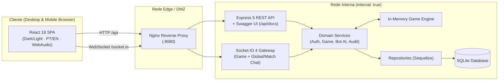

# Battleship — Combate Naval // Naval Warfare

[](https://battleship-ogod.onrender.com/)
[](https://battleship-ogod.onrender.com/api/docs)


Simulador estratégico de **Batalha Naval multijogador em tempo real** com interface tática inspirada em estações de comando naval. Construído com arquitetura em camadas no backend (**Node.js + Express 5 + Socket.IO 4 + Sequelize/SQLite**) e uma SPA reativa no frontend (**React 18 + Vite + Web Audio API**), com suporte completo a **Desktop e Mobile**, temas **Dark & Light** e internacionalização **Português / Inglês**.

---

## Demonstração Online (Live Demo)

- **Jogar Agora (Web & Mobile):** **[https://battleship-ogod.onrender.com/](https://battleship-ogod.onrender.com/)** *(possui acesso rápido com 1 clique via Modo Visitante / Guest Demo)*
- **Documentação Interativa da API (Swagger UI):** **[https://battleship-ogod.onrender.com/api/docs](https://battleship-ogod.onrender.com/api/docs)**
- **Status do Servidor (Health Check):** **[https://battleship-ogod.onrender.com/api/health](https://battleship-ogod.onrender.com/api/health)**

---

## Destaques de Engenharia & Produto

- **Servidor como Fonte Única de Verdade (*Authoritative Server*):** Clientes enviam apenas intenções (`placeFleet`, `fire`, `abandon`). O servidor valida turnos, contiguidade/alinhamento das embarcações, limites do grid 10×10 e aplica *Fog of War* (a posição da frota adversária nunca trafega na rede enquanto a partida está em andamento, sendo revelada somente ao término da operação).
- **Game Engine Híbrida (In-Memory + Persistência Transacional em SQLite):** Partidas ativas rodam em memória (`Map<gameId, GameState>`) para latência sub-milissegundo durante os turnos, enquanto cada disparo (`Shot`), embarcação (`Ship`) e transição de estado é persistido de forma transacional no SQLite.
- **IA Naval em 3 Níveis com Mapa de Densidade Probabilística:** Modo single-player contra a CPU (`POST /api/games/vs-bot`) com três níveis de dificuldade:
  - **Cadete (`easy`):** varredura aleatória.
  - **Comandante (`medium`):** algoritmo *Hunt & Target* com paridade em xadrez.
  - **Almirante (`hard`):** calcula em tempo real uma matriz de densidade probabilística (*heatmap*) considerando o comprimento de cada navio sobrevivente e persegue eixos colineares até o abate completo.
- **Chat Global Inteligente & Chat Tático da Partida:**
  - **Chat Global no Lobby (`lobby:chatSend`):** canal aberto para chamar jogadores online e enviar convites com 1 clique direto da mensagem, com **auto-limpeza automática (`lobby:chatCleared`)** sempre que todos os operadores ficam offline.
  - **Chat da Partida + Rádio Tático (`game:chatSend` / `game:signal`):** comunicação direta durante o combate, sinais rápidos de rádio e respostas automáticas contextualizadas quando o adversário é a CPU.
- **Sistema de Patentes Navais, Relatório Pós-Batalha & Revanche Instantânea:**
  - Progressão automática de patentes (`Guarda-Marinha` → `Tenente` → `Capitão de Fragata` → `Capitão de Mar e Guerra` → `Contra-Almirante` → `Almirante de Esquadra`).
  - Ao final da partida, o radar revela onde estavam escondidos os navios sobreviventes do oponente, exibe 6 métricas táticas (Turnos, Precisão, Maior Sequência de Acertos, Impactos, Abates e Frota Intacta) e permite pedir **Revanche Instantânea** contra humano ou CPU.
- **Experiência Visual, Temas, i18n, Áudio e Mobile-First:**
  - Temas **Dark (Carbon Obsidian)** e **Light (Alabaster Slate)** e alternância instantânea **PT-BR / EN**.
  - Animação de **Screen Shake + Onda Dupla de Sonar** ao afundar embarcações, áudio procedural via **Web Audio API** e trilha sonora iniciando em **10%** de volume por padrão.
  - Layout totalmente responsivo para **celulares e tablets** (reordenação automática do Radar Inimigo na batalha, barra rápida de posicionamento mobile e prevenção de auto-zoom em inputs).
- **Segurança, Documentação Swagger & Isolamento de Redes Docker:**
  - Headers HTTP de segurança (`CSP`, `X-Frame-Options`, `X-Content-Type-Options`) e *Rate Limiter* em janela deslizante.
  - Documentação interativa **Swagger UI** servida em `/api/docs` (especificação OpenAPI 3.0 em `/api/openapi.yaml`).
  - Topologia `docker-compose` com redes isoladas (`edge` pública e `app` com `internal: true`).

---

## Arquitetura do Sistema



---

## Stack Tecnológica

| Camada | Tecnologias |
| --- | --- |
| **Backend** | Node.js, Express 5, Socket.IO 4, Sequelize 6, SQLite3, JWT (`jsonwebtoken`), `bcrypt` |
| **Frontend** | React 18, React Router 6, Vite 5, Socket.IO Client, Web Audio API, CSS Custom Properties |
| **Qualidade & Testes** | Jest, Supertest (integração HTTP/WebSocket), Vitest, React Testing Library |
| **Infra & DevOps** | Docker (Multi-stage builds), Docker Compose (isolamento de redes), Nginx, GitHub Actions CI |

---

## Pré-requisitos

- **Node.js** 18+ (recomendado 22 LTS)
- **npm** 9+
- **Docker** e **Docker Compose** *(opcional, para execução containerizada)*

---

## Como Executar Localmente

### 1. Instalação e Build

```bash
# Instala as dependências do backend
npm install

# Instala as dependências do frontend e gera o bundle de produção em frontend/dist
npm run build

# Cria o arquivo de variáveis de ambiente
cp .env.example .env
```

### 2. Execução

```bash
# Modo Produção Unificado (Express serve a API, o Swagger, o Socket.IO e a SPA na porta 3000)
npm start

# Modo Desenvolvimento (em dois terminais separados)
npm run dev            # Terminal 1: Backend com hot-reload (nodemon) em http://localhost:3000
npm run frontend:dev   # Terminal 2: Frontend Vite com proxy em http://localhost:5173
```

- **Aplicação Web:** `http://localhost:3000`
- **Documentação Interativa da API (Swagger UI):** `http://localhost:3000/api/docs`

### 3. Suíte de Testes

```bash
# Testes unitários e de integração do backend (Jest + Supertest + Socket.IO)
npm test

# Cobertura de testes do backend
npm run coverage

# Testes unitários e de componentes do frontend (Vitest + Testing Library)
npm run frontend:test
```

---

## Execução com Docker

O projeto oferece dois modos de containerização:

### Topologia Multi-Container com Isolamento de Rede (`docker-compose.yml`)

Sobe dois containers em redes separadas (`edge` e `app`), expondo apenas o proxy reverso Nginx no host:

```text
Cliente ──▶ :8080 ─▶ [nginx] ──▶ [backend:3000] ──▶ volume SQLite
              edge      edge+app      app (internal)
```

```bash
cp .env.example .env
docker compose up -d --build
# Acesse em: http://localhost:8080
```

### Imagem Unificada (`Dockerfile`)

Compila o frontend e empacota junto ao backend Node.js em uma única imagem enxuta (`node:22-alpine`), ideal para plataformas de PaaS (Render, Fly.io, Railway):

```bash
docker build -t battleship .
docker run -p 3000:3000 -e JWT_SECRET=segredo-forte battleship
```

---

## Variáveis de Ambiente

| Variável | Default | Descrição |
| --- | --- | --- |
| `PORT` | `3000` | Porta do servidor HTTP e Socket.IO |
| `NODE_ENV` | `development` | Ambiente de execução (`development`, `test`, `production`) |
| `CORS_ORIGIN` | `*` | Origem permitida no CORS do Socket.IO |
| `JWT_SECRET` | — | Chave secreta usada na assinatura dos tokens JWT |
| `JWT_EXPIRES_IN` | `1d` | Tempo de expiração dos tokens JWT |
| `DB_STORAGE` | `./database.sqlite` | Caminho do arquivo de banco de dados SQLite (`:memory:` em `test`) |
| `DB_LOGGING` | `false` | Ativa logs das queries SQL no console (`true`/`false`) |
| `INVITATION_TTL_MS` | `300000` | Tempo de expiração de convites de partida (default: 5 minutos) |
| `RECONNECT_GRACE_MS` | `30000` | Janela de tolerância para reconexão antes de abandono automático (default: 30s) |
| `MAX_TURNS` | `300` | Limite máximo de turnos antes de declarar empate |

---

## Estrutura do Projeto

```text
.
├── .github/workflows/       # Pipeline de Integração Contínua (GitHub Actions)
├── docs/                    # Documentação técnica detalhada e especificação OpenAPI 3.0
├── frontend/                # Aplicação SPA (React 18 + Vite)
│   ├── public/              # Assets estáticos (favicon vetorial, áudio)
│   └── src/
│       ├── components/      # Componentes visuais (TacticalGrid, ShipyardDock, PreferenceControls...)
│       ├── context/         # Contextos globais (AuthContext, SocketContext)
│       ├── lib/             # Regras de tabuleiro, reducer, preferências (Tema/i18n/Patentes) e WebAudio
│       ├── pages/           # Páginas (AuthPage, LobbyPage, GamePage)
│       └── styles/          # Design system Dark/Light & Mobile-First (CSS modular)
├── src/                     # Backend (Node.js + Express 5 + Socket.IO 4)
│   ├── config/              # Configuração do Sequelize / SQLite
│   ├── controllers/         # Adaptadores HTTP (parse de request e formatação de response)
│   ├── middlewares/         # Autenticação JWT, Security Headers, Rate Limiter e Error Handler
│   ├── models/              # Entidades Sequelize (User, Game, Invitation, Ship, Shot, AuditLog)
│   ├── repositories/        # Camada de persistência e queries encapsuladas
│   ├── routes/              # Definição de rotas REST (/api/*)
│   ├── services/            # Regras de negócio, Game Engine em memória e IA Probabilística do Bot
│   ├── socket/              # Gateway Socket.IO, presença, Chat Global e Chat da Partida
│   ├── utils/               # Classes de erro de domínio padronizadas (AppError)
│   └── app.js               # Instância Express + Swagger UI (/api/docs)
├── tests/                   # Suíte de testes automatizados do backend (Jest + Supertest)
├── Dockerfile               # Build multi-stage unificado (SPA + Backend)
├── Dockerfile.backend       # Build isolado do serviço de backend
├── docker-compose.yml       # Orquestração com redes segmentadas (edge + app)
└── server.js                # Entrypoint HTTP, WebSocket e inicialização do banco
```

---

## Documentação Técnica

A documentação aprofundada de cada subsistema encontra-se no diretório [`docs/`](./docs/README.md):

- [**Arquitetura e Fluxos**](./docs/ARCHITECTURE.md) — Camadas, decisões de design, máquina de estados e diagramas de sequência.
- [**Modelo de Dados**](./docs/DATA_MODEL.md) — Diagrama Entidade-Relacionamento (ER), dicionário de dados e regras de integridade.
- [**Referência da API REST**](./docs/API.md) · [**Especificação OpenAPI 3.0**](./docs/openapi.yaml) — Endpoints, payloads, códigos de status e tratamento de erros.
- [**Catálogo de Eventos Socket.IO**](./docs/SOCKET_EVENTS.md) — Protocolo em tempo real, rooms, chat global/partida, acknowledgements e reconexão.

---

## Licença

Distribuído sob a licença **MIT**. Consulte o arquivo [`LICENSE`](./LICENSE) para mais detalhes.
