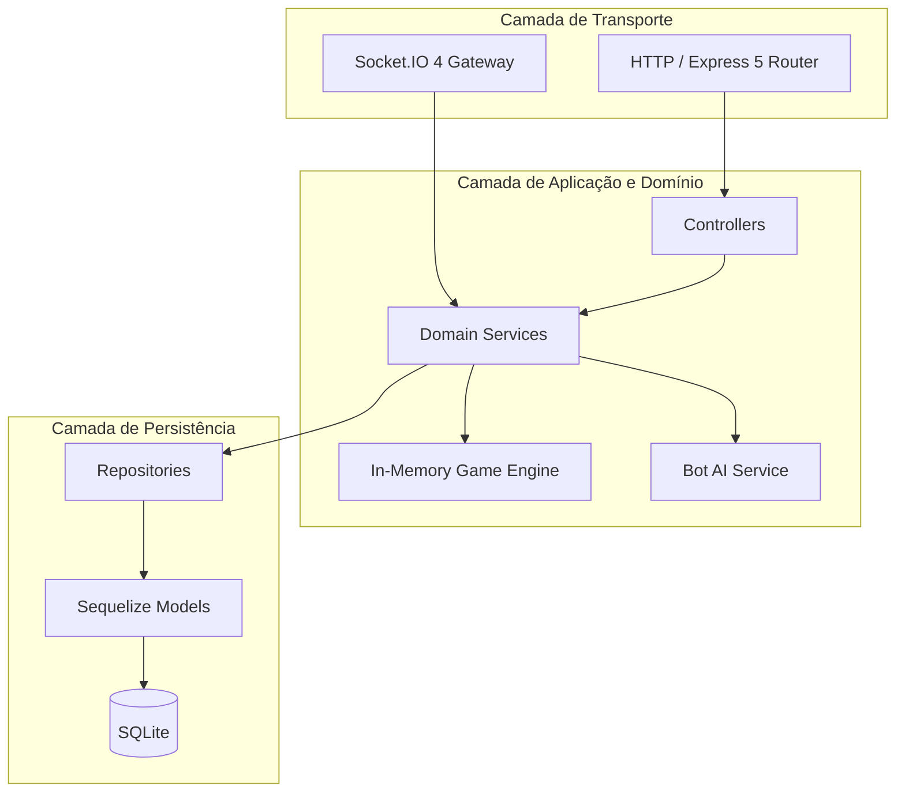
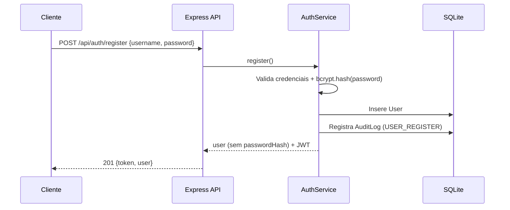
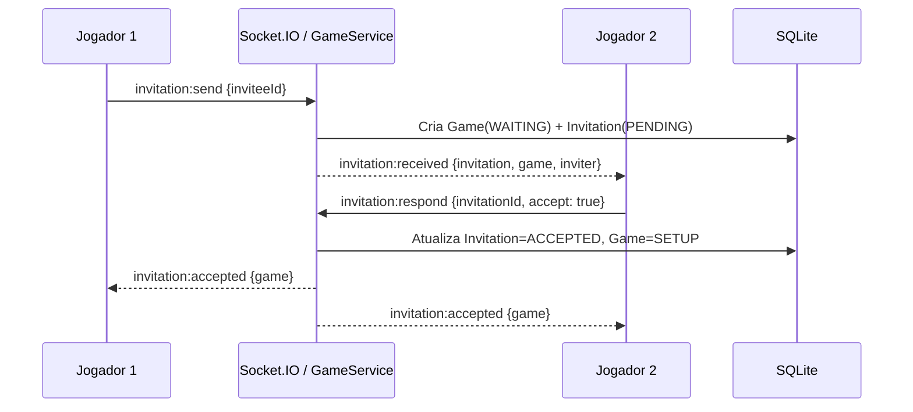
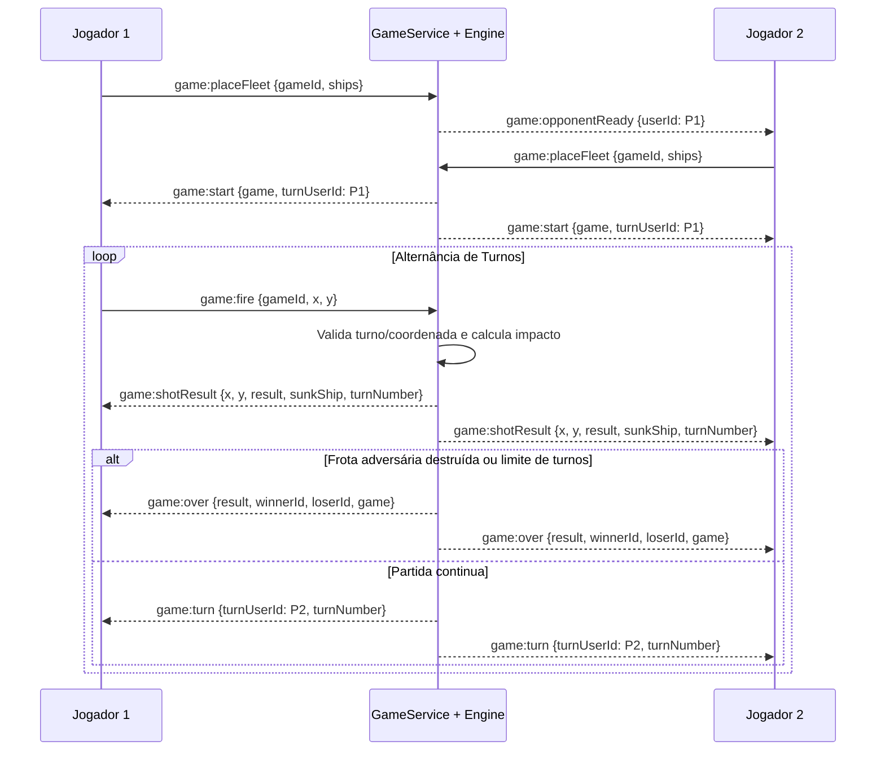
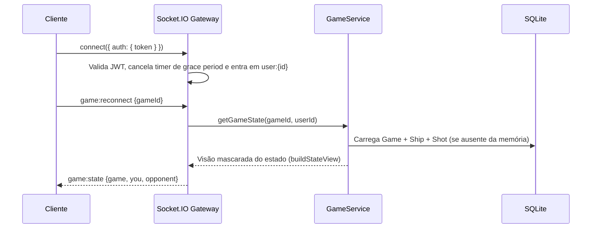
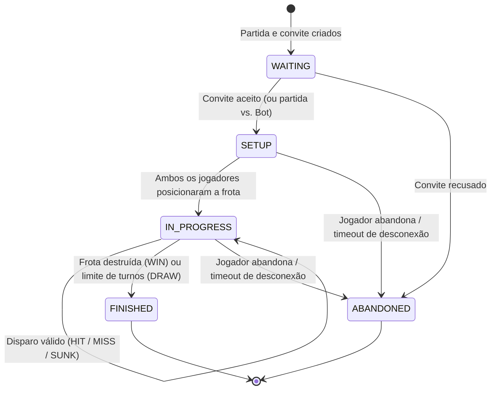

# Arquitetura do Sistema

## 1. Estilo Arquitetural

O backend adota uma **arquitetura em camadas** (*Layered Architecture*) com separação estrita de responsabilidades e independência de transporte. O fluxo de uma requisição REST segue:

```text
route → controller → service → repository → model (Sequelize) → SQLite
```

O gateway **Socket.IO** consome exatamente os mesmos **services** da camada de domínio, garantindo que todas as regras de negócio, validações e registros de auditoria residam em um único ponto, independentemente de a ação ter vindo por HTTP ou WebSocket.



## 2. Estrutura de Diretórios

```text
src/
├── config/          # Configuração da conexão Sequelize/SQLite
├── controllers/     # Adaptação HTTP: leitura de req e escrita de res
├── middlewares/     # Autenticação JWT e tratamento centralizado de erros
├── models/          # Definição das entidades e associações (Sequelize)
├── repositories/    # Acesso a dados e queries encapsuladas sobre os models
├── routes/          # Mapeamento de rotas REST (/api/*)
├── services/        # Regras de negócio (auth, partidas, engine, bot, auditoria)
├── socket/          # Gateway de eventos Socket.IO, presença e emissão para rooms
├── utils/           # Erros customizados de domínio (AppError)
└── app.js           # Configuração da aplicação Express (desacoplada do server.js)
```

| Camada | Responsabilidade | O que não deve conter |
| --- | --- | --- |
| `routes` | Mapear verbo + caminho para um controller e encadear middlewares | Lógica de negócio ou queries |
| `controllers` | Traduzir HTTP (`req`, `res`, `next`) ↔ chamadas de serviço | Acesso direto ao banco ou regras de domínio |
| `services` | Regras de negócio, orquestração transacional e emissão de eventos de domínio | Conhecimento de objetos `req`/`res` do Express |
| `repositories` | Consultas e persistência encapsuladas sobre os modelos Sequelize | Validações de turno ou regras de negócio |
| `models` | Esquema das tabelas, tipos de colunas e relacionamentos | Lógica de aplicação |
| `socket` | Handshake autenticado, presença e roteamento de eventos WebSocket | Regras de negócio (delega integralmente aos `services`) |

## 3. Decisões de Engenharia

### 3.1 Engine em Memória + Persistência Durável (Reidratação)
Partidas em andamento são mantidas em memória (`Map<gameId, GameState>`) no `gameEngineService`, proporcionando validações de turno e colisão em tempo constante $\mathcal{O}(1)$ sem sobrecarga de I/O. Simultaneamente, o banco SQLite persiste:
- `Game` — metadados, status, jogadores, vencedor, resultado, contagem de turnos e timestamps;
- `Ship` — posicionamento das frotas de cada jogador;
- `Shot` — histórico sequencial de cada disparo efetuado (`x`, `y`, `result`, `sunkShip`, `turnNumber`);
- `AuditLog` — trilha de auditoria de eventos críticos do sistema.

Caso o processo do servidor seja reiniciado ou o estado em memória seja descartado, a função `ensureState` reconstrói o `GameState` completo de forma transparente a partir de `Game`, `Ship` e `Shot` (`buildFromDb`).

### 3.2 Registro de Presença em Memória
A lista de operadores online é mantida em memória (`userId → { username, sockets: Set<socketId>, connectedAt }`), suportando múltiplas abas/conexões simultâneas por usuário: o jogador só transita para `OFFLINE` quando seu último socket ativo é desconectado. Para escalabilidade horizontal futura (múltiplas réplicas), o módulo `presence.js` e o `emitter.js` podem ser acoplados ao `@socket.io/redis-adapter`.

### 3.3 Segurança e Autenticação
- Senhas nunca são armazenadas ou logadas em texto claro; utiliza-se hash **bcrypt** (`SALT_ROUNDS = 10`), e o campo `passwordHash` é omitido em todas as serializações (`toPublicUser`).
- Sessões stateless via **JWT** (`Authorization: Bearer <token>` nas rotas REST e `socket.handshake.auth.token` no WebSocket).
- **Sigilo de Estado (*Fog of War*):** Durante `SETUP` e `IN_PROGRESS`, o endpoint `GET /api/games/:id` e o evento `game:state` mascaram completamente a frota do oponente (`opponent.ships = []`), revelando-a apenas quando a partida atinge `FINISHED` ou `ABANDONED`.

### 3.4 Confiabilidade e Validação Rigorosa
- O servidor valida integralmente a frota enviada: quantidade exata de embarcações (5), tipos únicos, tamanhos exatos, coordenadas dentro do grid 10×10, ausência de sobreposição e **alinhamento contíguo** (horizontal ou vertical).
- Desconexões acidentais acionam um *grace period* (`RECONNECT_GRACE_MS`, padrão 30s). Se o jogador reconectar dentro da janela, o timer de abandono é cancelado e a partida prossegue normalmente.

## 4. Fluxos Principais

### 4.1 Registro e Autenticação



### 4.2 Convite e Aceite de Partida



### 4.3 Posicionamento, Turnos e Sincronização



### 4.4 Reconexão e Reidratação



## 5. Máquina de Estados da Partida



## 6. Observabilidade e Auditoria

- **Logs de Aplicação:** estruturados por contexto (`[http]`, `[db]`, `[socket]`, `[bot]`, `[audit]`).
- **Trilha de Auditoria Persistida (`AuditLog`):** registra automaticamente eventos de ciclo de vida de usuários (`USER_REGISTER`, `USER_LOGIN`, `USER_LOGOUT`, `USER_CONNECTED`, `USER_DISCONNECTED`), partidas (`GAME_CREATED`, `INVITATION_SENT`, `INVITATION_ACCEPTED`, `INVITATION_REJECTED`, `GAME_START`, `MOVE_MADE`, `GAME_END`, `GAME_ABANDONED`) e falhas inesperadas (`ERROR` em respostas HTTP 5xx ou exceções assíncronas).
