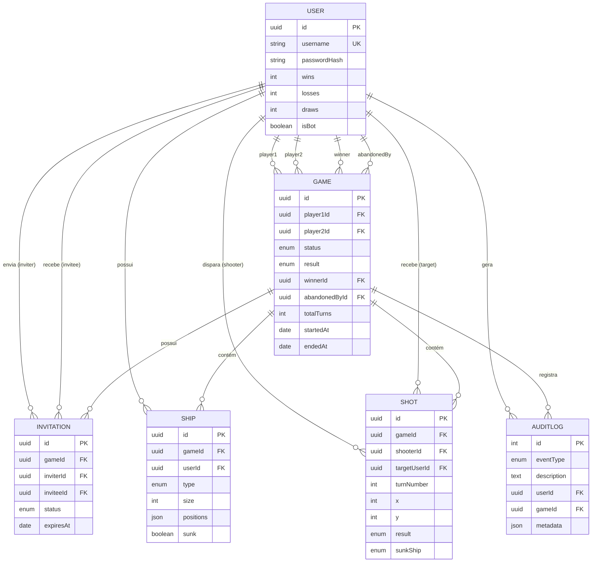

# Modelo de Dados

Banco de dados relacional **SQLite** gerenciado via **Sequelize 6**. Todas as tabelas possuem colunas de auditoria temporal (`createdAt`, `updatedAt`) habilitadas via `timestamps: true`.

## 1. Diagrama Entidade-Relacionamento (ER)

> O estado de **presença online** é efêmero de sessão e mantido em memória pelo gateway Socket.IO (`src/socket/presence.js`), não exigindo tabela dedicada no banco.

## 2. Dicionário de Dados

### `User` (`Users`)
| Campo | Tipo | Restrições | Descrição |
| --- | --- | --- | --- |
| `id` | `UUID` | PK, default `UUIDV4` | Identificador único do usuário |
| `username` | `STRING` | único, `3–20` chars, obrigatório | Nome de operador (busca case-insensitive) |
| `passwordHash` | `STRING` | obrigatório | Hash bcrypt da senha (nunca exposto na API) |
| `wins` | `INTEGER` | default `0` | Total de vitórias acumuladas |
| `losses` | `INTEGER` | default `0` | Total de derrotas acumuladas |
| `draws` | `INTEGER` | default `0` | Total de empates acumulados |
| `isBot` | `BOOLEAN` | default `false` | Identifica se o operador é controlado pela CPU |

### `Game` (`Games`)
| Campo | Tipo | Restrições | Descrição |
| --- | --- | --- | --- |
| `id` | `UUID` | PK, default `UUIDV4` | Identificador único da partida |
| `player1Id` | `UUID` | FK `User`, obrigatório | Jogador criador/desafiante |
| `player2Id` | `UUID` | FK `User`, nulo até o aceite | Jogador convidado/adversário |
| `status` | `ENUM` | default `'WAITING'` | `WAITING`, `SETUP`, `IN_PROGRESS`, `FINISHED`, `ABANDONED` |
| `result` | `ENUM` | nulo enquanto em andamento | `WIN` ou `DRAW` |
| `winnerId` | `UUID` | FK `User`, nulo | Vencedor da partida (nulo em caso de empate) |
| `abandonedById` | `UUID` | FK `User`, nulo | Usuário que abandonou ou desconectou por timeout |
| `totalTurns` | `INTEGER` | default `0` | Número total de disparos efetuados na partida |
| `startedAt` | `DATE` | nulo | Data/hora em que ambas as frotas ficaram prontas |
| `endedAt` | `DATE` | nulo | Data/hora de encerramento da partida |

### `Invitation` (`Invitations`)
| Campo | Tipo | Restrições | Descrição |
| --- | --- | --- | --- |
| `id` | `UUID` | PK, default `UUIDV4` | Identificador único do convite |
| `gameId` | `UUID` | FK `Game`, obrigatório | Partida associada ao convite |
| `inviterId` | `UUID` | FK `User`, obrigatório | Jogador que enviou o convite |
| `inviteeId` | `UUID` | FK `User`, obrigatório | Jogador destinatário do convite |
| `status` | `ENUM` | default `'PENDING'` | `PENDING`, `ACCEPTED`, `REJECTED`, `EXPIRED` |
| `expiresAt` | `DATE` | nulo | Data/hora limite para resposta ao convite |

### `Ship` (`Ships`)
| Campo | Tipo | Restrições | Descrição |
| --- | --- | --- | --- |
| `id` | `UUID` | PK, default `UUIDV4` | Identificador único do registro de navio |
| `gameId` | `UUID` | FK `Game`, obrigatório | Partida à qual a embarcação pertence |
| `userId` | `UUID` | FK `User`, obrigatório | Jogador proprietário da embarcação |
| `type` | `ENUM` | obrigatório | `CARRIER`, `BATTLESHIP`, `CRUISER`, `SUBMARINE`, `DESTROYER` |
| `size` | `INTEGER` | obrigatório | Comprimento da embarcação em células (`2` a `5`) |
| `positions` | `JSON` | obrigatório | Array de coordenadas contíguas `[{ "x": 0, "y": 0 }, ...]` |
| `sunk` | `BOOLEAN` | default `false` | Indica se todas as posições foram atingidas |

### `Shot` (`Shots`)
| Campo | Tipo | Restrições | Descrição |
| --- | --- | --- | --- |
| `id` | `UUID` | PK, default `UUIDV4` | Identificador único do disparo |
| `gameId` | `UUID` | FK `Game`, obrigatório | Partida em que o disparo ocorreu |
| `shooterId` | `UUID` | FK `User`, obrigatório | Jogador que efetuou o disparo |
| `targetUserId` | `UUID` | FK `User`, obrigatório | Jogador cujo tabuleiro recebeu o disparo |
| `turnNumber` | `INTEGER` | obrigatório | Número sequencial do turno na partida |
| `x` | `INTEGER` | `0–9`, obrigatório | Coordenada horizontal (coluna `A–J`) |
| `y` | `INTEGER` | `0–9`, obrigatório | Coordenada vertical (linha `1–10`) |
| `result` | `ENUM` | obrigatório | `MISS`, `HIT` ou `SUNK` |
| `sunkShip` | `ENUM` | nulo se `result ≠ SUNK` | Tipo da embarcação afundada pelo disparo |

### `AuditLog` (`AuditLogs`)
| Campo | Tipo | Restrições | Descrição |
| --- | --- | --- | --- |
| `id` | `INTEGER` | PK, autoincrement | Identificador sequencial do log |
| `eventType` | `ENUM` | obrigatório | Tipo do evento auditado (ver lista abaixo) |
| `description` | `TEXT` | obrigatório | Descrição legível do evento |
| `userId` | `UUID` | FK `User`, nulo | Usuário associado ao evento |
| `gameId` | `UUID` | FK `Game`, nulo | Partida associada ao evento |
| `metadata` | `JSON` | nulo | Contexto estruturado adicional (coordenadas, stack, motivo) |

**Valores de `eventType`:** `USER_REGISTER`, `USER_LOGIN`, `USER_LOGOUT`, `USER_CONNECTED`, `USER_DISCONNECTED`, `GAME_CREATED`, `INVITATION_SENT`, `INVITATION_ACCEPTED`, `INVITATION_REJECTED`, `GAME_START`, `MOVE_MADE`, `GAME_END`, `GAME_ABANDONED`, `ERROR`.

## 3. Regras de Integridade e Domínio

- `username` é único de forma *case-insensitive* (`LOWER(username)`), preservando a grafia original escolhida no cadastro.
- `Game.player1Id ≠ Game.player2Id` (não é permitido convidar a si mesmo).
- Uma partida encerrada (`FINISHED` ou `ABANDONED`) sempre possui `endedAt` preenchido.
- `result = 'DRAW'` implica `winnerId = null`; `result = 'WIN'` implica `winnerId` preenchido e atualização atômica de `wins`/`losses` dos participantes.
- Usuários marcados com `isBot = true` são filtrados automaticamente da consulta pública de ranking (`GET /api/scoreboard`).

## 4. Composição Padrão do Tabuleiro e Frota

- **Dimensões:** Grade **10 × 10** (100 setores), com coordenadas `x, y ∈ [0, 9]`.
- **Frota Padrão (5 embarcações, 17 setores no total):**
  - `CARRIER` — Porta-aviões (5 setores)
  - `BATTLESHIP` — Encouraçado (4 setores)
  - `CRUISER` — Cruzador (3 setores)
  - `SUBMARINE` — Submarino (3 setores)
  - `DESTROYER` — Contratorpedeiro (2 setores)
- **Condição de Vitória:** Destruição de todos os 17 setores da frota adversária ou desistência/timeout do oponente.
