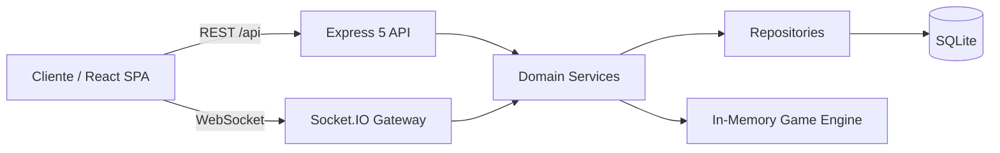

# Documentação Técnica — Battleship (Combate Naval)

Documentação de engenharia do sistema **Battleship**, construído com **Node.js + Express 5 + Sequelize 6 + SQLite** no backend, **Socket.IO 4** para comunicação bidirecional em tempo real e **React 18 + Vite** no frontend.

## Índice

| Documento | Conteúdo |
| --- | --- |
| [ARCHITECTURE.md](./ARCHITECTURE.md) | Arquitetura em camadas, responsabilidades, decisões de engenharia e fluxos de sequência (Mermaid). |
| [DATA_MODEL.md](./DATA_MODEL.md) | Modelo de dados (ER), dicionário de tabelas, enums e regras de integridade. |
| [API.md](./API.md) | Referência completa da API REST (endpoints, exemplos de payloads, respostas e erros). |
| [openapi.yaml](./openapi.yaml) | Especificação formal OpenAPI 3.0.3 da API REST. |
| [SOCKET_EVENTS.md](./SOCKET_EVENTS.md) | Catálogo de eventos Socket.IO (client ↔ server), gerenciamento de rooms, bot e reconexão. |

## Visão Geral do Sistema

- **REST (`/api`)**: cobre autenticação (registro, login, sessão), consultas (usuários online, ranking, histórico de partidas) e operações atômicas (criação de partida vs. bot, posicionamento de frota, disparos, abandono).
- **Socket.IO**: gerencia presença em tempo real, envio/resposta de convites, sincronização instantânea de turnos/disparos e reconexão automática.
- **Game Engine Híbrida**: mantém as partidas ativas em memória para validação rápida de turnos e persiste todas as embarcações, disparos e eventos de auditoria no SQLite, permitindo reconstruir qualquer partida após um reinício do processo.

## Convenções

- Todos os endpoints REST são prefixados por `/api`.
- Autenticação via **JWT** no header `Authorization: Bearer <token>` (REST) e em `socket.handshake.auth.token` (Socket.IO).
- Nenhuma resposta da API ou evento WebSocket expõe `passwordHash` ou as posições da frota adversária enquanto a partida está em andamento (*Fog of War*).
- Coordenadas do tabuleiro: colunas `A–J` (`x` de `0` a `9`) e linhas `1–10` (`y` de `0` a `9`).
- Timestamps trafegam no padrão **ISO 8601 UTC**.
