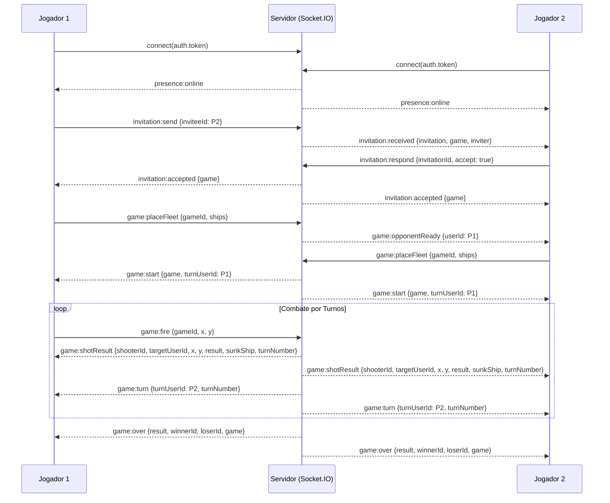

# Catálogo de Eventos Socket.IO

Canal bidirecional em tempo real para presença no lobby, negociação de convites, posicionamento de frota, sincronização de disparos e reconexão.

- **URL:** `ws://localhost:3000` (mesmo host/porta do servidor HTTP)
- **Biblioteca:** `socket.io` v4
- **CORS:** controlado pela variável de ambiente `CORS_ORIGIN`

## 1. Autenticação e Rooms

O token JWT obtido no login/registro deve ser enviado no handshake da conexão:

```js
import { io } from 'socket.io-client';

const socket = io('http://localhost:3000', {
  auth: { token },
});
```

O servidor valida o JWT no middleware de conexão (`io.use`). Caso o token esteja ausente ou seja inválido, o handshake é recusado com `Error('UNAUTHORIZED')`.

Após a conexão, o socket é associado às seguintes *rooms*:

| Room | Descrição |
| --- | --- |
| `user:{userId}` | Canal privado do usuário (recebimento de convites e notificações direcionadas) |
| `game:{gameId}` | Canal da partida (ingressa automaticamente ao aceitar um convite ou chamar `game:reconnect`) |

## 2. Eventos Client → Server

Todos os comandos enviados pelo cliente suportam *acknowledgement* (`callback`) no formato `{ ok: true, data }` em caso de sucesso ou `{ ok: false, error: { code, message } }` em caso de falha.

| Evento | Payload | Descrição |
| --- | --- | --- |
| `lobby:listOnline` | — | Solicita a lista atual de usuários online. |
| `lobby:chatHistory` | — | Solicita o histórico recente de mensagens do Chat Global do Lobby. |
| `lobby:chatSend` | `{ text }` | Envia uma mensagem no Chat Global do Lobby (máx. 240 caracteres). |
| `invitation:send` | `{ inviteeId }` | Cria uma partida `WAITING` e envia convite ao usuário online indicado. |
| `invitation:respond` | `{ invitationId, accept }` | Aceita (`true`) ou recusa (`false`) um convite recebido. |
| `game:placeFleet` | `{ gameId, ships }` | Posiciona as 5 embarcações do jogador na fase `SETUP`. |
| `game:fire` | `{ gameId, x, y }` | Efetua um disparo na coordenada `(x, y)` durante o seu turno. |
| `game:abandon` | `{ gameId }` | Abandona a partida ativa, concedendo vitória ao oponente. |
| `game:reconnect` | `{ gameId }` | Solicita a reidratação completa do estado da partida e reingressa na room `game:{gameId}`. |
| `game:chatHistory` | `{ gameId }` | Solicita o histórico de mensagens do chat tático da partida. |
| `game:chatSend` | `{ gameId, text }` | Envia uma mensagem no chat da partida (a CPU responde automaticamente se o oponente for um Bot). |
| `game:signal` | `{ gameId, code }` | Envia um sinal rápido de rádio (`NICE_SHOT`, `LOCKED`, `CLOSE`, `GG`) para a partida. |

## 3. Eventos Server → Client

| Evento | Payload | Destino | Descrição |
| --- | --- | --- | --- |
| `presence:online` | `{ users: [{ id, username }] }` | broadcast | Lista completa de operadores online atualizada. |
| `presence:updated` | `{ userId, status }` | broadcast | Mudança de status de um operador (`ONLINE` ou `OFFLINE`). |
| `lobby:chatMessage` | `{ id, userId, username, text, sentAt }` | broadcast | Nova mensagem publicada no Chat Global do Lobby. |
| `lobby:chatCleared` | — | broadcast | Emitido quando todos os jogadores ficam offline e o histórico do Chat Global é limpo. |
| `invitation:received` | `{ invitation, game, inviter }` | `user:{inviteeId}` | Notifica o convidado sobre um novo desafio recebido. |
| `invitation:accepted` | `{ game }` | `user:{player1Id}`, `user:{player2Id}` | Notifica ambos os jogadores que o convite foi aceito (`SETUP`). |
| `invitation:rejected` | `{ invitationId }` | `user:{inviterId}` | Notifica o desafiante que o convite foi recusado. |
| `game:opponentReady` | `{ userId }` | `user:{opponentId}` | Informa que o adversário já confirmou sua frota. |
| `game:start` | `{ game, turnUserId }` | `game:{gameId}` | Ambas as frotas posicionadas; combate iniciado (`IN_PROGRESS`). |
| `game:state` | `{ game, you, opponent }` | socket (privado) | Snapshot completo (com frota inimiga mascarada se em andamento) após `game:reconnect`. |
| `game:shotResult` | `{ shooterId, targetUserId, x, y, result, sunkShip, turnNumber }` | `game:{gameId}` | Resultado de um disparo (`MISS`, `HIT` ou `SUNK`). |
| `game:turn` | `{ turnUserId, turnNumber }` | `game:{gameId}` | Indica de quem é a vez após um disparo que não encerrou o jogo. |
| `game:over` | `{ result, winnerId, loserId, game, fleets }` | `game:{gameId}` | Encerramento da partida (`WIN` ou `DRAW`) com revelação das frotas (`fleets`). |
| `game:opponentLeft` | `{ userId, reason }` | `game:{gameId}` | Informa que o adversário abandonou a partida (`ABANDONED`). |
| `game:chatMessage` | `{ id, gameId, senderId, senderName, text, sentAt }` | participantes | Nova mensagem no chat tático da partida. |
| `game:signal` | `{ gameId, senderId, senderName, code, sentAt }` | participantes | Sinal rápido de rádio enviado durante a partida. |
| `error` | `{ code, message }` | socket (privado) | Erro de validação ou conflito de estado. |

### Códigos de Erro (`error.code`)

| Código | Significado |
| --- | --- |
| `UNAUTHORIZED` | Token JWT ausente, inválido ou expirado no handshake. |
| `USER_NOT_FOUND` | Usuário convidado não existe. |
| `USER_OFFLINE` | Tentativa de convidar um usuário que não está online. |
| `INVITATION_EXPIRED` | O convite atingiu o tempo limite (`INVITATION_TTL_MS`). |
| `NOT_YOUR_TURN` | Tentativa de disparo fora do turno do jogador. |
| `INVALID_MOVE` | Frota inválida, coordenada fora do grid `0–9` ou célula já alvejada. |
| `NOT_PARTICIPANT` | Usuário não pertence à partida ou ao convite informado. |
| `GAME_ALREADY_OVER` | Operação inválida porque a partida não está em andamento ou já foi encerrada. |

## 4. Diagrama de Sequência Completo



## 5. Turnos Automáticos do Bot e Tolerância a Desconexões

- **Partidas contra a CPU (`isBot: true`):** Quando o jogador humano efetua um disparo e a partida continua, o servidor emite `game:turn` passando a vez para o Bot e agenda via `setImmediate` a execução de `botService.playBotTurn`. O Bot calcula seu disparo (*Hunt & Target*) e emite `game:shotResult` e um novo `game:turn` devolvendo a vez ao jogador humano.
- **Janela de Tolerância (*Grace Period*):** Se a última conexão de um jogador cair durante uma partida em `SETUP` ou `IN_PROGRESS`, o servidor aguarda `RECONNECT_GRACE_MS` (padrão: `30000` ms).
  - Se o jogador reconectar antes do término da janela, o timer é cancelado automaticamente.
  - Caso o tempo expire e o jogador permaneça offline, o servidor executa o abandono automático da partida, emitindo `game:opponentLeft` e `game:over` com vitória para o oponente.
